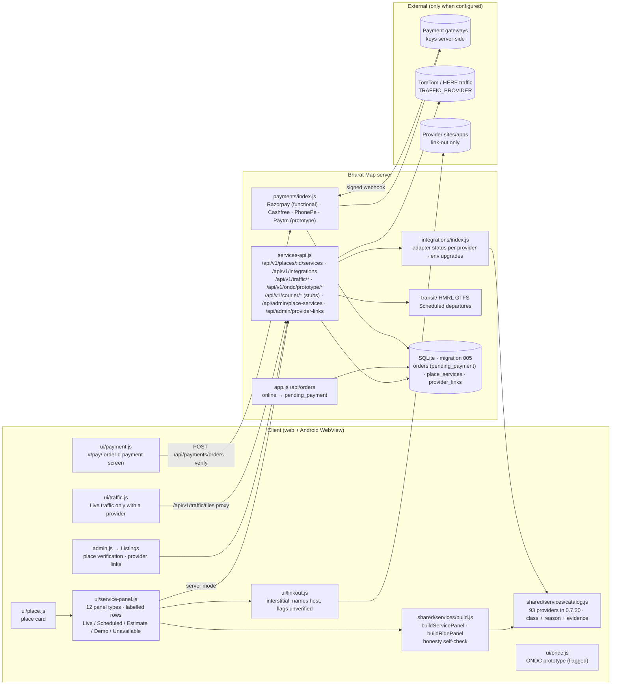
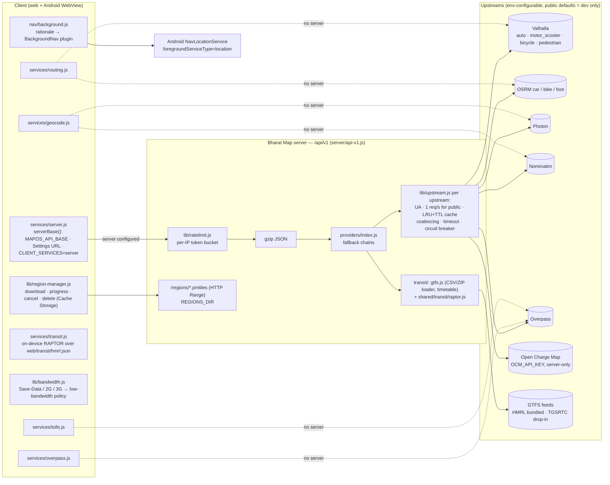
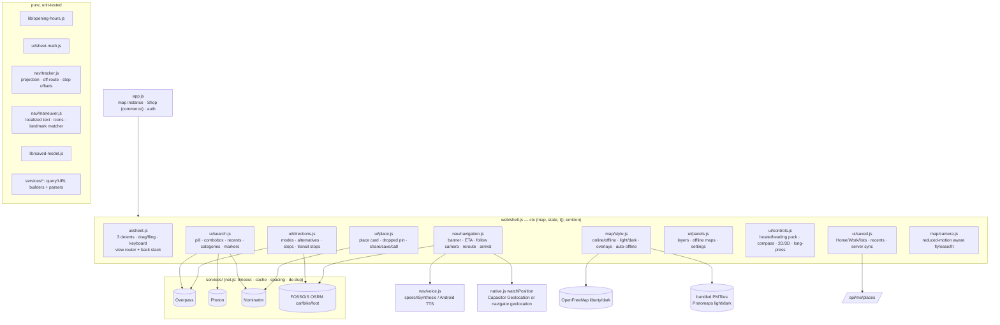
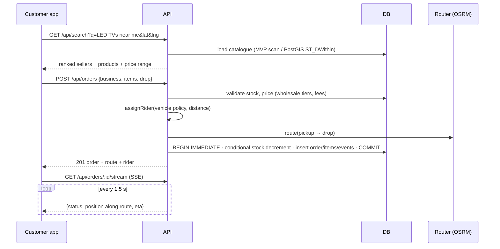

# Architecture

Canonical architecture document for Bharat Map (merged from the former `docs/ARCHITECTURE.md`, which is now a pointer).
State described: **v0.7.20** (commit `810a020`, 3 Nov 2026). Every path below exists in the repo; diagrams for older
layers (v0.3–v0.7) are kept further down because those layers are still the running code.

Related: [API.md](API.md) (every route) · [DATABASE.md](DATABASE.md) (schema) · [SETUP.md](SETUP.md) (run, configure,
deploy, sign) · [FEATURES.md](FEATURES.md) (what is implemented / prototype / external / missing) ·
[DECISIONS.md](DECISIONS.md) (why) · deep references: [docs/SELF_HOSTING.md](docs/SELF_HOSTING.md),
[docs/OFFLINE_ROUTING.md](docs/OFFLINE_ROUTING.md), [docs/ANDROID.md](docs/ANDROID.md),
[docs/re/COMAPS_TEARDOWN.md](docs/re/COMAPS_TEARDOWN.md) (the architectural blueprint).

## A. System at a glance

```
┌──────────────── Client: one web app (web/) ────────────────┐      ┌──────────── Bharat Map server (server/) ────────────┐
│ MapLibre GL JS 6.15 (vendored, web/vendor/)                 │      │ Express 4 (Node ≥ 22.13), node:sqlite (SQLite WAL)  │
│ shell.js + ui/ + nav/ + services/ + map/ + lib/             │ REST │ app.js     ops, auth, Shop, orders, SSE, payments,  │
│ shared/ (isomorphic, symlinked as web/shared)               │ SSE  │            notifications, /map tile proxy, /ondc    │
│ Runs as: browser (served by the server) or Android WebView  │─────▶│ api-v1.js  /api/v1 map services (+ community.js)    │
│ (Capacitor 7, www/ built by scripts/build-www.mjs)          │      │ services-api.js  v0.7 panels, traffic, ONDC proto   │
│ Offline: 11 bundled PMTiles cities, search index, GTFS packs│      │ admin.js   /api/admin/*                             │
└──────────────┬──────────────────────────────────────────────┘      └───────┬───────────────────────────────┬────────────┘
               │ no server configured → calls open services directly           │ providers/ + lib/upstream.js  │ db/migrations
               ▼                                                               ▼                               ▼
   OpenFreeMap tiles · Overpass · Photon · Nominatim · FOSSGIS OSRM/Valhalla · OSM Notes API     data/mapos.db, data/search.db
```

* **One client, two runtimes.** `web/` is served by the Express server (`express.static`) and is also copied into `www/`
  for the Android app by `scripts/build-www.mjs` (dereferences the `web/shared → ../shared` symlink, drops `sw.js`,
  writes `config.js` with `MAPOS_API_BASE`, patches the CSP `<meta>` to allow that backend).
* **Two service modes, same client code.** `web/services/server.js#serverBase()` decides: with a backend
  (`MAPOS_API_BASE` at build time, Settings → Backend server, or `CLIENT_SERVICES=server` on a server-hosted web app) the
  client calls `/api/v1/*`; otherwise (and on failure) it calls the public OSM services directly. With no backend the
  Android app runs fully on-device and Shop uses the in-browser backend `web/mock-api.js` with fictional demo data.
* **Isomorphic core.** `shared/` holds pure, unit-tested logic used by both the server and the browser (search ranking,
  address/DIGIPIN, logistics state machine, transit RAPTOR, Valhalla request building, guardrails, i18n, CSP).
* **Honesty layer.** Every value shown on a place card carries a label (Live / Scheduled / Estimate / Link-out / Demo /
  Unavailable) built by `shared/services/build.js` and checked by `shared/services/labels.js#panelViolations()`.

## B. Repository map (verified paths)

| Path | What lives there |
|---|---|
| `server/index.js` | Entry point: `createApp()` + listen on `PORT` (default 8080), graceful SIGTERM/SIGINT |
| `server/app.js` | `createApp()`: security headers + CSP, request ids, metrics, CORS, JSON/urlencoded parsers (raw body kept for webhooks), legacy `/api` rate limit, live-user re-check, gzip, `/config.js`, static `web/` + `/shared`, `/map/*` tile proxy, ops, auth, Shop/search/geo/mobility, orders + SSE, seller, payments, notifications, `/ondc/search`; exports `VERSION = '0.7.0'` and `orderView()` |
| `server/api-v1.js` | `/api/v1` router (token-bucket limiter, 512 kb JSON) + `/regions/*.pmtiles` static with Range |
| `server/community.js` | `/api/v1/incidents*`, `/api/v1/live*` (mounted inside api-v1) |
| `server/services-api.js` | v0.7 routes mounted into `/api/v1` via `app.locals.v1Extra`, plus `/api/admin/place-services`, `/api/admin/provider-links` |
| `server/admin.js` | `/api/admin/*` dashboard routes (role admin, audited) |
| `server/auth.js` | scrypt hashing, HS256 JWT, `requireRole`, `assertAuthConfig` |
| `server/db.js` | `openDb()` (WAL, FKs, auto-migrate `db/migrations/*.sql`), `seed()` demo data, `demoPasswordFor()` |
| `server/providers/index.js` | Upstream fallback chains for `/api/v1` (`MODES = drive, two, bike, walk, truck`) |
| `server/lib/` | `upstream.js` (UA, 1 req/s public throttle, LRU+TTL, coalescing, timeout, breaker), `lru.js`, `ratelimit.js`, `search-fts.js` (FTS5 search DB) |
| `server/payments/index.js` | Razorpay (functional) + Cashfree / PhonePe / Paytm (prototype) adapters, each enabled only by its env keys |
| `server/services/` | `external.js` (legacy adapters: route, geocode, Overpass, LLM rewrite), `ondc.js` (Beckn catalogue shape), `payments.js` (Razorpay client) |
| `server/integrations/index.js` | Adapter registry per catalogue provider (status only, never keys); traffic provider config |
| `server/transit/` | `gtfs.js` loader, `index.js` service; bundled feeds `feeds/hmrl/` (official HMRL) and `feeds/bmrcl/` (unofficial ODbL) with `ATTRIBUTION.txt` |
| `server/notify.js` | Persisted notification fan-out (no FCM sender) |
| `shared/` | Isomorphic core — see section C |
| `web/` | Client: `index.html`, `app.js` (map instance + Shop + auth), `shell.js`, `ui/` (23 modules), `nav/` (9), `services/` (11 + `providers/`), `map/` (3), `lib/` (12), `sw.js`, `styles.css`, `mock-api.js`, `native.js`, `offline-map.js`, `admin.js` |
| `web/offline/` | 11 bundled `*.pmtiles` (81,396,970 bytes total), `catalog.json` (9 downloadable regions), `regions.json`, `pois/`, `search/index.json`, `fonts/`, `sprites/` |
| `web/transit/` | Packed client timetables `hmrl.json`, `bmrcl.json`, `index.json` (built by `scripts/build-transit.mjs`) |
| `db/migrations/` | SQLite migrations 001–006 (applied automatically) · `db/postgis/` target schema (not used by the running server) |
| `android/` | Capacitor 7 project, package `com.indiamapos.app`; own plugins `BackgroundNavPlugin` + `NavLocationService`, `ExternalAppPlugin` |
| `scripts/` | Build/data scripts (see [SETUP.md](SETUP.md#scripts)) |
| `tests/` | `node:test` unit + API suites (19 files in `npm test`), `e2e.mjs` + `e2e-net.mjs` (Playwright-core Chromium, fixture-served network), `e2e-demo.mjs`, `load.mjs`, `fixtures/` |
| `data/deeplinks/` | Only tracked part of `data/`: APK-manifest and assetlinks evidence for app hand-offs |
| `.github/workflows/` | `ci.yml` (test → e2e + android → release), `attach-apk.yml` (manual) |
| `docs/` | Deep references, audits, test reports, research (`docs/re/`), screenshots |

## C. Module layers (v0.5 → v0.7.20, not drawn in the older diagrams)

| Layer | Modules | Notes |
|---|---|---|
| Navigation extras (v0.5) | `shared/lanes.js`, `shared/maxspeed.js`, `shared/sun.js`, `web/nav/junction.js`, `web/nav/sounds.js` | Lane strip, speed limit only when known, NOAA day/night, schematic junction, WebAudio cues |
| Community (v0.5) | `shared/community.js`, `server/community.js`, `web/services/community.js`, `web/ui/report.js` | Anonymous OSM notes; 2-hour unverified incidents; live location shares (id + secret) |
| Deep links in (v0.5) | `shared/deeplink.js`, `web/ui/links.js`, `MainActivity` intent filters | `geo:` and `bharatmap://` inbound; https share links |
| Device tiers / search v2 / road hints (sprint 0.5.11, files named `v06`) | `web/lib/device-tier.js`, `shared/search-index.js`, `shared/translit.js`, `web/lib/offline-search.js`, `server/lib/search-fts.js`, `shared/roadhints.js`, `web/nav/voices.js` | One token index for all 11 cities; FTS5 on the server |
| Place-card services (v0.7) | `shared/services/*`, `web/ui/service-panel.js`, `web/ui/linkout.js`, `web/ui/payment.js`, `web/ui/traffic.js`, `web/ui/ondc.js` | Diagram in section 1 below |
| App hand-offs out (0.7.15–0.7.16) | `shared/services/deeplinks.js`, `shared/services/deeplinks-web.js`, `ExternalAppPlugin.java` | Documented / App Link / Declared·Unverified / Store / Web-only; payment schemes refused |
| CoMaps phase 0 (released 0.7.17, files named `v08`) | `shared/geoformats.js`, `web/lib/track-model.js`, `web/ui/tracks.js`, `shared/osm-edit.js`, `web/ui/osm-edit.js`, `web/lib/file-io.js` | GPX/KML, tracks, suggest-an-edit notes |
| UI/UX pass (0.7.18) | `web/lib/ux.js`, `web/ui/states.js`, `web/ui/map-health.js`, `web/styles.css` | A1–A7, A15 |
| Competitor gaps (0.7.20) | `shared/guardrails.js`, `shared/valhalla.js` (`MAIN_ROADS`), `shared/search-locality.js`, `shared/alarms.js` + `web/nav/alarms.js`, `shared/route-alerts.js`, `shared/handoff.js` + `web/lib/clipboard.js`, `shared/reroute.js` | G1, G2, G7–G10, G3/G6 part |

## D. Architecture rules (enforced by code or tests)

1. **Clean-room, open data only.** OSM and open datasets; no Google/Mappls code, tiles or data; reference apps are studied
   for behaviour only (`docs/re/`). Reused code must be listed in `docs/THIRD_PARTY.md` (currently none).
2. **India envelope.** Every coordinate input is checked with `shared/geo.js#inIndia`; out-of-box points return
   `400 invalid_point(s)` / `invalid_line` / `outside_india`.
3. **Money is INR integers.** Prices, fees and totals are integer rupees (`products.price INTEGER`, `orders.total INTEGER`),
   GST-inclusive by project convention; gateways receive paise (`Math.round(total * 100)`).
4. **No secrets on the client.** Gateway, traffic and OCM keys stay server-side; `/api/config`, `/api/payments/config` and
   `/api/v1/integrations` report booleans only.
5. **Only a server-verified payment confirms an order** (signature / server-to-server re-check / signed webhook).
6. **No `upi://` or other payment-scheme intents**; refused by `intentUrl()`, `safeIntent()`, `safeLinkout()` and the
   native plugin.
7. **Honesty labels everywhere**; Demo is never Live; no fabricated prices, fares, showtimes or ETAs (`tests/v07.test.js`).
8. **Public upstreams are dev-only** and are throttled to ≥ 1 s between requests with an identifying User-Agent.
9. **Same CSP** in the HTTP header and the app-shell `<meta>` (`shared/csp.js`); the Android build adds only its backend.


---

# Layer diagrams (history of the running code, newest first)

## v0.7 — place-card service panels, provider catalogue, payments



* **Order → payment.** An online order is created `pending_payment` (not confirmed, no rider). The separate payment screen
  asks the server to create the gateway order (amount from our DB); only a server-verified payment (signature or
  server-to-server status re-check, webhook as backstop) flips it to paid and starts tracking. No keys → "Payments not
  configured"; COD is unaffected.
* **Truthful panels.** Every row carries a source and a freshness label. `buildServicePanel` runs an honesty self-check
  (no Live without a feed, Demo never Live, no amounts without a live quote) that the tests run over every sample place.
* **Admin links.** Links an admin adds are stored unverified and reach the public panel only after verification; all
  changes are audited.
* **Truck routing.** `/api/v1/route?mode=truck` uses Valhalla truck costing (`truck_height/width/length/weight/axle_load`,
  `truck_hazmat`); if Valhalla is unreachable it returns a labelled fallback and never substitutes a car route.

## v0.4 — integrated map-services backend



* **Two modes, same client code.** Every client service first asks `serverBase()`. With a Bharat Map server it calls
  `/api/v1/*`; if that fails (or there is no server) it calls the public OSM services directly, exactly as v0.3 did.
* **Fallback chains** (server and client): route = Valhalla ⇄ OSRM (Valhalla first for two-wheeler, avoid tolls/highways,
  or when `VALHALLA_URL` is self-hosted) → labelled straight-line estimate; geocode = Photon → Nominatim; EV = Open
  Charge Map (keyed) → OSM via Overpass. Results say which engine answered (`engine`, `provider`, `tried`).
* **Upstream hygiene** (`server/lib/upstream.js`): identifying `User-Agent`, ≥ 1 s between requests to any public instance
  (queued in order), identical in-flight requests coalesced, LRU + TTL cache, per-request timeout, circuit breaker
  (3 consecutive failures → skip for 30 s; 4xx never trips it). Per-IP token bucket on `/api/v1` and gzip for JSON > 1 KB.
* **Transit**: GTFS (zip / folder / .txt.gz) → compact timetable (patterns, trips sorted by first departure, services with
  calendar_dates exceptions, footpaths for same-station and ≤ 250 m transfers) → RAPTOR rounds (walk → ride → transfer →
  ride → walk), Pareto over number of rides. Server and client share `shared/transit/raptor.js`; the client ships the
  packed HMRL timetable (≈ 160 KB, lossless `shared/transit/pack.js`). All times are labelled *scheduled, not live*.
* **Tolls**: the selected route is simplified (Douglas–Peucker, ≤ 180 vertices) into an Overpass `around` polyline query
  for `barrier=toll_booth` / `highway=toll_gantry` and `toll=yes` ways; plazas are projected onto the route, ordered by
  distance along it, and booths on both carriageways within 350 m are merged. No fees are shown.
* **Low bandwidth**: policy from `navigator.connection` (or manual) → max zoom 16, no low-zoom tile prefetch
  (`prefetchZoomDelta 0`), no 3D, Overpass area 3 km and fewer POIs; server gzip + coalescing; on unmetered connections
  the route corridor's z12–14 tiles are prefetched into the tile cache when navigation starts.
* **Offline regions**: catalogue `web/offline/catalog.json` (9 cities); files cut by `scripts/make-region.sh`
  (`pmtiles extract` from the Protomaps daily build) and served from `REGIONS_DIR`; the app downloads them into Cache
  Storage with progress / cancel / delete and `offline-map.js` prefers a downloaded region that covers the map centre.
* **Background navigation (Android)**: `BackgroundNavPlugin` starts `NavLocationService` (foreground service, type
  `location`, persistent notification) only during GPS navigation after a one-time rationale; fixes are forwarded to the
  same tracker. `ACCESS_BACKGROUND_LOCATION` is requested only from the optional Settings button.

## 0. v0.3 client (map-first shell)



* **One map, one sheet.** `app.js` owns the MapLibre instance and the commerce code (now the *Shop* view inside the sheet);
  `shell.js` builds a small context object and hands it to each module. Modules talk through `ctx.emit/on` events
  (`view`, `view-leave`, `lang`, `theme`, `location`, `mapstyle`, `nav`) instead of importing each other's internals.
* **Overlays survive style switches.** `map/style.js` re-adds Bharat Map layers (`bm-routes`, `bm-pois`, `bm-buildings-3d`,
  `bm-transit`) on every `style.load`, detecting the vector schema (OpenMapTiles online vs Protomaps offline).
* **Auto-offline.** A failed style load or ≥ 6 tile errors in 15 s (or the browser `offline` event) switches to the bundled
  PMTiles region; the `online` event switches back unless the user forced offline.
* **Navigation pipeline.** Position fix (GPS or simulator) → `tracker.update()` (snap to route, along-distance, next
  maneuver, remaining distance/time, off-route counter, arrival) → banner + ETA + camera → voice on maneuver change and
  again ≤ 60 m before it (≤ 25 m walking). Off-route for 3 consecutive fixes > 50 m (widened by poor accuracy) → new OSRM
  route from the current fix.
* **Privacy.** Location is requested only by the locate button, “Directions” from your location, or navigation. CSP
  (`shared/csp.js`) is identical in the server header and the app-shell `<meta>`; the Android build adds only its
  configured backend.

## 1. MVP (as built in v0.1–v0.2)

```mermaid
flowchart LR
  subgraph Client["Web / PWA (Android via Capacitor)"]
    UI[MapLibre GL UI<br/>search · cart · tracking · seller · assistant]
    SH1[shared/ core<br/>i18n · pricing preview]
    MOCK[in-browser backend<br/>serverless demo]
  end
  subgraph API["Node 22 · Express (stateless)"]
    AUTH[Auth JWT + scrypt · RBAC]
    SRCH[Search & AI intents]
    GEO[Address intelligence · DIGIPIN · geocode/reverse]
    LOG[Orders · rider assignment · SSE tracking]
    SELL[Seller / Admin]
    ONDC[ONDC Beckn adapter (prototype)]
    TP[Tile/style proxy + cache]
    OPS[/health · /metrics · logs/]
  end
  DB[(SQLite WAL<br/>→ PostGIS)]
  OSRM[OSRM routing]
  NOM[Nominatim]
  OVP[Overpass (OSM POIs)]
  OFM[OpenFreeMap vector tiles<br/>→ self-hosted PMTiles]
  LLM[(Optional LLM)]
  UI -->|REST + SSE| API
  UI -.static demo.-> MOCK
  API --> DB
  LOG --> OSRM
  GEO --> NOM
  SRCH -.optional.-> LLM
  API --> OVP
  TP --> OFM
```

The **shared/** folder is isomorphic: the same search ranking, address parser, DIGIPIN codec, pricing,
rider assignment and tracking state machine run on the server and in the browser, so the serverless
demo behaves exactly like the API.

## 2. Target production architecture (phase 2–3)

```mermaid
flowchart TB
  CDN[CDN + WAF<br/>tiles · static · rate limits] --> LB[Load balancer]
  LB --> APIx[API pods (N) · autoscaled]
  APIx --> PG[(PostgreSQL 16 + PostGIS + h3<br/>primary + read replicas)]
  APIx --> REDIS[(Redis<br/>cache · sessions · geo sets for riders)]
  APIx --> BUS[[Event bus: NATS / Kafka<br/>order.* · rider.ping · inventory.*]]
  BUS --> DISP[Dispatch service<br/>VROOM batching]
  BUS --> TRK[Tracking fan-out<br/>WebSocket/SSE gateway]
  BUS --> IDX[Search indexer → OpenSearch/Typesense]
  DISP --> VAL[Valhalla (2W, auto, car, truck)]
  DISP --> OSRMT[OSRM (matrix tables)]
  APIx --> PH[Photon/Nominatim self-hosted]
  APIx --> ONDCG[ONDC gateway/registry<br/>signed Beckn calls]
  RIDER[Rider app GPS] --> TRK
  PMT[(PMTiles on object storage<br/>planetiler nightly, SoI boundaries)] --> CDN
  OBS[Prometheus · Grafana · Loki · OpenTelemetry] -.-> APIx
```

## 3. Data model (MVP)

```mermaid
erDiagram
  USERS ||--o{ BUSINESSES : owns
  USERS ||--o{ ORDERS : places
  BUSINESSES ||--o{ PRODUCTS : lists
  BUSINESSES ||--o{ ORDERS : fulfils
  RIDERS ||--o{ ORDERS : delivers
  ORDERS ||--|{ ORDER_ITEMS : contains
  ORDERS ||--o{ ORDER_EVENTS : logs
  PRODUCTS ||--o{ ORDER_ITEMS : "sold as"
  USERS { text id PK; text email UK; text role; text password_hash; text preferred_lang }
  BUSINESSES { text id PK; text owner_id FK; text type; text category; real lat; real lng; text digipin; int verified; real rating }
  PRODUCTS { text id PK; text business_id FK; int price; int mrp; int stock; int wholesale_price; int min_wholesale_qty; text tags }
  RIDERS { text id PK; text vehicle; real lat; real lng; int available }
  ORDERS { text id PK; text status; text fulfilment; text payment_method; int total; text route_json; int created_ms }
  MOBILITY_POIS { text id PK; text kind; real lat; real lng; text source }
```

Schemas: `db/migrations/001_init.sql` (SQLite, applied automatically, tracked in `schema_migrations`) and
`db/postgis/001_init.sql` (geography points + GiST, h3 cells, trigram/tsvector search, partitioned orders and
rider pings, row-level security for sellers).

## 4. Key flows



**Tracking is a pure function of time** (`shared/logistics.js#progress`): status and position derive from
`created_ms`, route geometry and duration. Any API instance can answer any tracking request (no sticky
sessions); in production the position source swaps from simulation to rider GPS pings.

## 5. Technology choices (summary — evidence in [docs/RESEARCH.md](docs/RESEARCH.md) §3)
| Concern | MVP | Production | Why |
|---|---|---|---|
| Rendering | MapLibre GL JS (4.7 in the MVP; 6.15 vendored in `web/vendor/` today) | + MapLibre Native Android | BSD-3, vector, 3D, no vendor lock |
| Tiles | OpenFreeMap via same-origin proxy | planetiler → PMTiles on object storage + CDN | Free, ODbL; SoI boundaries patched in build |
| Routing | OSRM (public demo / self-host) | Valhalla primary (2W, truck), OSRM matrices, VROOM | Licence (BSD/MIT), Indian vehicle profiles |
| Geocoding | Own address parser + DIGIPIN + Nominatim fallback | Photon type-ahead + Nominatim + pincode/DIGIPIN tables | Landmark addresses need custom logic |
| DB | SQLite (node:sqlite, WAL) | PostgreSQL + PostGIS + h3 | Zero-ops pilot → spatial scale |
| Search | In-process ranking | PostGIS + tsvector → OpenSearch/Typesense | |
| AI | Deterministic intent engine (+ optional LLM rewrite) | LLM planner with tool calls over these APIs | Explainable, cheap, offline-safe baseline |
