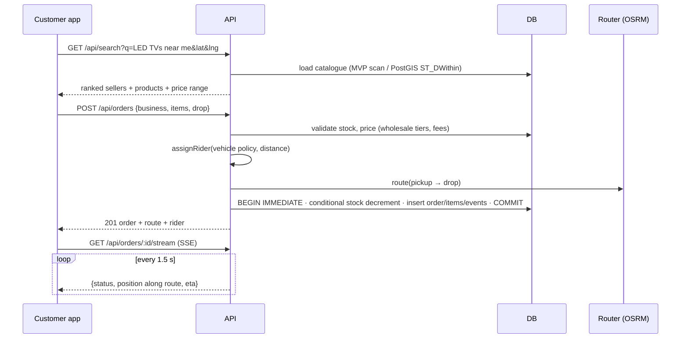

# Architecture

## 1. MVP (as built)

```mermaid
flowchart LR
  subgraph Client["Web / PWA (Android via Capacitor)"]
    UI[MapLibre GL UI<br/>search · cart · tracking · seller · assistant]
    SH1[shared/ core<br/>i18n · pricing preview]
    MOCK[in-browser backend<br/>serverless demo]
  end
  subgraph API["Node 22 · Express (stateless)"]
    AUTH[Auth JWT + scrypt · RBAC]
    SRCH[Search & AI intents]
    GEO[Address intelligence · DIGIPIN · geocode/reverse]
    LOG[Orders · rider assignment · SSE tracking]
    SELL[Seller / Admin]
    ONDC[ONDC Beckn adapter (prototype)]
    TP[Tile/style proxy + cache]
    OPS[/health · /metrics · logs/]
  end
  DB[(SQLite WAL<br/>→ PostGIS)]
  OSRM[OSRM routing]
  NOM[Nominatim]
  OVP[Overpass (OSM POIs)]
  OFM[OpenFreeMap vector tiles<br/>→ self-hosted PMTiles]
  LLM[(Optional LLM)]
  UI -->|REST + SSE| API
  UI -.static demo.-> MOCK
  API --> DB
  LOG --> OSRM
  GEO --> NOM
  SRCH -.optional.-> LLM
  API --> OVP
  TP --> OFM
```

The **shared/** folder is isomorphic: the same search ranking, address parser, DIGIPIN codec, pricing,
rider assignment and tracking state machine run on the server and in the browser, so the serverless
demo behaves exactly like the API.

## 2. Target production architecture (phase 2–3)

```mermaid
flowchart TB
  CDN[CDN + WAF<br/>tiles · static · rate limits] --> LB[Load balancer]
  LB --> APIx[API pods (N) · autoscaled]
  APIx --> PG[(PostgreSQL 16 + PostGIS + h3<br/>primary + read replicas)]
  APIx --> REDIS[(Redis<br/>cache · sessions · geo sets for riders)]
  APIx --> BUS[[Event bus: NATS / Kafka<br/>order.* · rider.ping · inventory.*]]
  BUS --> DISP[Dispatch service<br/>VROOM batching]
  BUS --> TRK[Tracking fan-out<br/>WebSocket/SSE gateway]
  BUS --> IDX[Search indexer → OpenSearch/Typesense]
  DISP --> VAL[Valhalla (2W, auto, car, truck)]
  DISP --> OSRMT[OSRM (matrix tables)]
  APIx --> PH[Photon/Nominatim self-hosted]
  APIx --> ONDCG[ONDC gateway/registry<br/>signed Beckn calls]
  RIDER[Rider app GPS] --> TRK
  PMT[(PMTiles on object storage<br/>planetiler nightly, SoI boundaries)] --> CDN
  OBS[Prometheus · Grafana · Loki · OpenTelemetry] -.-> APIx
```

## 3. Data model (MVP)

```mermaid
erDiagram
  USERS ||--o{ BUSINESSES : owns
  USERS ||--o{ ORDERS : places
  BUSINESSES ||--o{ PRODUCTS : lists
  BUSINESSES ||--o{ ORDERS : fulfils
  RIDERS ||--o{ ORDERS : delivers
  ORDERS ||--|{ ORDER_ITEMS : contains
  ORDERS ||--o{ ORDER_EVENTS : logs
  PRODUCTS ||--o{ ORDER_ITEMS : "sold as"
  USERS { text id PK; text email UK; text role; text password_hash; text preferred_lang }
  BUSINESSES { text id PK; text owner_id FK; text type; text category; real lat; real lng; text digipin; int verified; real rating }
  PRODUCTS { text id PK; text business_id FK; int price; int mrp; int stock; int wholesale_price; int min_wholesale_qty; text tags }
  RIDERS { text id PK; text vehicle; real lat; real lng; int available }
  ORDERS { text id PK; text status; text fulfilment; text payment_method; int total; text route_json; int created_ms }
  MOBILITY_POIS { text id PK; text kind; real lat; real lng; text source }
```

Schemas: `db/migrations/001_init.sql` (SQLite, applied automatically, tracked in `schema_migrations`) and
`db/postgis/001_init.sql` (geography points + GiST, h3 cells, trigram/tsvector search, partitioned orders and
rider pings, row-level security for sellers).

## 4. Key flows



**Tracking is a pure function of time** (`shared/logistics.js#progress`): status and position derive from
`created_ms`, route geometry and duration. Any API instance can answer any tracking request (no sticky
sessions); in production the position source swaps from simulation to rider GPS pings.

## 5. Technology choices (summary — evidence in RESEARCH.md §3)
| Concern | MVP | Production | Why |
|---|---|---|---|
| Rendering | MapLibre GL JS 4.7 (vendored) | + MapLibre Native Android | BSD-3, vector, 3D, no vendor lock |
| Tiles | OpenFreeMap via same-origin proxy | planetiler → PMTiles on object storage + CDN | Free, ODbL; SoI boundaries patched in build |
| Routing | OSRM (public demo / self-host) | Valhalla primary (2W, truck), OSRM matrices, VROOM | Licence (BSD/MIT), Indian vehicle profiles |
| Geocoding | Own address parser + DIGIPIN + Nominatim fallback | Photon type-ahead + Nominatim + pincode/DIGIPIN tables | Landmark addresses need custom logic |
| DB | SQLite (node:sqlite, WAL) | PostgreSQL + PostGIS + h3 | Zero-ops pilot → spatial scale |
| Search | In-process ranking | PostGIS + tsvector → OpenSearch/Typesense | |
| AI | Deterministic intent engine (+ optional LLM rewrite) | LLM planner with tool calls over these APIs | Explainable, cheap, offline-safe baseline |
