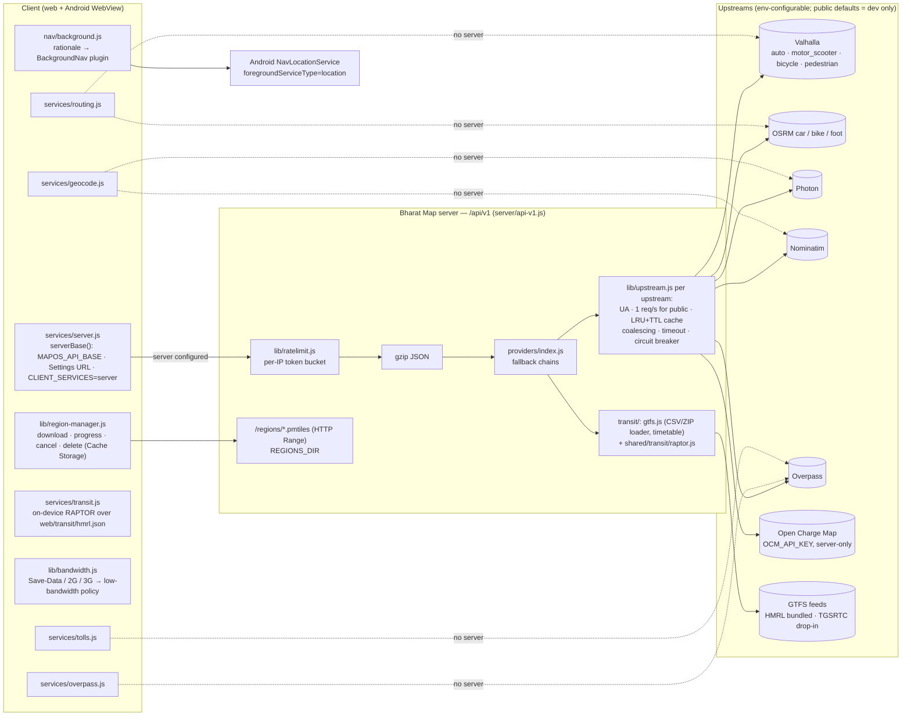
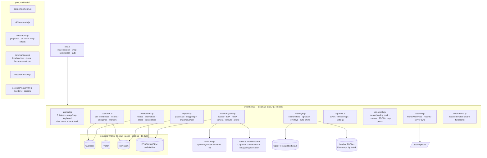
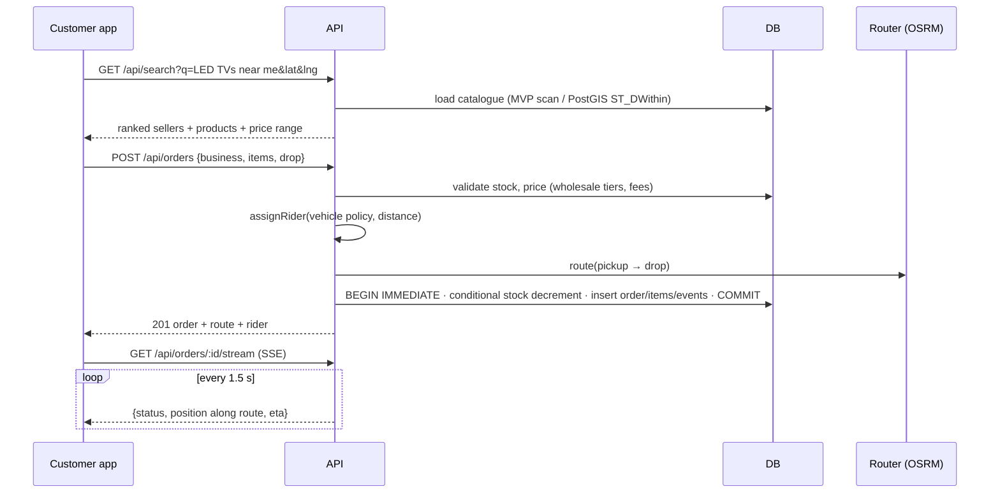

# Architecture

## v0.4 — integrated map-services backend



* **Two modes, same client code.** Every client service first asks `serverBase()`. With a Bharat Map server it calls
  `/api/v1/*`; if that fails (or there is no server) it calls the public OSM services directly, exactly as v0.3 did.
* **Fallback chains** (server and client): route = Valhalla ⇄ OSRM (Valhalla first for two-wheeler, avoid tolls/highways,
  or when `VALHALLA_URL` is self-hosted) → labelled straight-line estimate; geocode = Photon → Nominatim; EV = Open
  Charge Map (keyed) → OSM via Overpass. Results say which engine answered (`engine`, `provider`, `tried`).
* **Upstream hygiene** (`server/lib/upstream.js`): identifying `User-Agent`, ≥ 1 s between requests to any public instance
  (queued in order), identical in-flight requests coalesced, LRU + TTL cache, per-request timeout, circuit breaker
  (3 consecutive failures → skip for 30 s; 4xx never trips it). Per-IP token bucket on `/api/v1` and gzip for JSON > 1 KB.
* **Transit**: GTFS (zip / folder / .txt.gz) → compact timetable (patterns, trips sorted by first departure, services with
  calendar_dates exceptions, footpaths for same-station and ≤ 250 m transfers) → RAPTOR rounds (walk → ride → transfer →
  ride → walk), Pareto over number of rides. Server and client share `shared/transit/raptor.js`; the client ships the
  packed HMRL timetable (≈ 160 KB, lossless `shared/transit/pack.js`). All times are labelled *scheduled, not live*.
* **Tolls**: the selected route is simplified (Douglas–Peucker, ≤ 180 vertices) into an Overpass `around` polyline query
  for `barrier=toll_booth` / `highway=toll_gantry` and `toll=yes` ways; plazas are projected onto the route, ordered by
  distance along it, and booths on both carriageways within 350 m are merged. No fees are shown.
* **Low bandwidth**: policy from `navigator.connection` (or manual) → max zoom 16, no low-zoom tile prefetch
  (`prefetchZoomDelta 0`), no 3D, Overpass area 3 km and fewer POIs; server gzip + coalescing; on unmetered connections
  the route corridor's z12–14 tiles are prefetched into the tile cache when navigation starts.
* **Offline regions**: catalogue `web/offline/catalog.json` (9 cities); files cut by `scripts/make-region.sh`
  (`pmtiles extract` from the Protomaps daily build) and served from `REGIONS_DIR`; the app downloads them into Cache
  Storage with progress / cancel / delete and `offline-map.js` prefers a downloaded region that covers the map centre.
* **Background navigation (Android)**: `BackgroundNavPlugin` starts `NavLocationService` (foreground service, type
  `location`, persistent notification) only during GPS navigation after a one-time rationale; fixes are forwarded to the
  same tracker. `ACCESS_BACKGROUND_LOCATION` is requested only from the optional Settings button.

## 0. v0.3 client (map-first shell)



* **One map, one sheet.** `app.js` owns the MapLibre instance and the commerce code (now the *Shop* view inside the sheet);
  `shell.js` builds a small context object and hands it to each module. Modules talk through `ctx.emit/on` events
  (`view`, `view-leave`, `lang`, `theme`, `location`, `mapstyle`, `nav`) instead of importing each other's internals.
* **Overlays survive style switches.** `map/style.js` re-adds Bharat Map layers (`bm-routes`, `bm-pois`, `bm-buildings-3d`,
  `bm-transit`) on every `style.load`, detecting the vector schema (OpenMapTiles online vs Protomaps offline).
* **Auto-offline.** A failed style load or ≥ 6 tile errors in 15 s (or the browser `offline` event) switches to the bundled
  PMTiles region; the `online` event switches back unless the user forced offline.
* **Navigation pipeline.** Position fix (GPS or simulator) → `tracker.update()` (snap to route, along-distance, next
  maneuver, remaining distance/time, off-route counter, arrival) → banner + ETA + camera → voice on maneuver change and
  again ≤ 60 m before it (≤ 25 m walking). Off-route for 3 consecutive fixes > 50 m (widened by poor accuracy) → new OSRM
  route from the current fix.
* **Privacy.** Location is requested only by the locate button, “Directions” from your location, or navigation. CSP
  (`shared/csp.js`) is identical in the server header and the app-shell `<meta>`; the Android build adds only its
  configured backend.

## 1. MVP (as built in v0.1–v0.2)

```mermaid
flowchart LR
  subgraph Client["Web / PWA (Android via Capacitor)"]
    UI[MapLibre GL UI<br/>search · cart · tracking · seller · assistant]
    SH1[shared/ core<br/>i18n · pricing preview]
    MOCK[in-browser backend<br/>serverless demo]
  end
  subgraph API["Node 22 · Express (stateless)"]
    AUTH[Auth JWT + scrypt · RBAC]
    SRCH[Search & AI intents]
    GEO[Address intelligence · DIGIPIN · geocode/reverse]
    LOG[Orders · rider assignment · SSE tracking]
    SELL[Seller / Admin]
    ONDC[ONDC Beckn adapter (prototype)]
    TP[Tile/style proxy + cache]
    OPS[/health · /metrics · logs/]
  end
  DB[(SQLite WAL<br/>→ PostGIS)]
  OSRM[OSRM routing]
  NOM[Nominatim]
  OVP[Overpass (OSM POIs)]
  OFM[OpenFreeMap vector tiles<br/>→ self-hosted PMTiles]
  LLM[(Optional LLM)]
  UI -->|REST + SSE| API
  UI -.static demo.-> MOCK
  API --> DB
  LOG --> OSRM
  GEO --> NOM
  SRCH -.optional.-> LLM
  API --> OVP
  TP --> OFM
```

The **shared/** folder is isomorphic: the same search ranking, address parser, DIGIPIN codec, pricing,
rider assignment and tracking state machine run on the server and in the browser, so the serverless
demo behaves exactly like the API.

## 2. Target production architecture (phase 2–3)

```mermaid
flowchart TB
  CDN[CDN + WAF<br/>tiles · static · rate limits] --> LB[Load balancer]
  LB --> APIx[API pods (N) · autoscaled]
  APIx --> PG[(PostgreSQL 16 + PostGIS + h3<br/>primary + read replicas)]
  APIx --> REDIS[(Redis<br/>cache · sessions · geo sets for riders)]
  APIx --> BUS[[Event bus: NATS / Kafka<br/>order.* · rider.ping · inventory.*]]
  BUS --> DISP[Dispatch service<br/>VROOM batching]
  BUS --> TRK[Tracking fan-out<br/>WebSocket/SSE gateway]
  BUS --> IDX[Search indexer → OpenSearch/Typesense]
  DISP --> VAL[Valhalla (2W, auto, car, truck)]
  DISP --> OSRMT[OSRM (matrix tables)]
  APIx --> PH[Photon/Nominatim self-hosted]
  APIx --> ONDCG[ONDC gateway/registry<br/>signed Beckn calls]
  RIDER[Rider app GPS] --> TRK
  PMT[(PMTiles on object storage<br/>planetiler nightly, SoI boundaries)] --> CDN
  OBS[Prometheus · Grafana · Loki · OpenTelemetry] -.-> APIx
```

## 3. Data model (MVP)

```mermaid
erDiagram
  USERS ||--o{ BUSINESSES : owns
  USERS ||--o{ ORDERS : places
  BUSINESSES ||--o{ PRODUCTS : lists
  BUSINESSES ||--o{ ORDERS : fulfils
  RIDERS ||--o{ ORDERS : delivers
  ORDERS ||--|{ ORDER_ITEMS : contains
  ORDERS ||--o{ ORDER_EVENTS : logs
  PRODUCTS ||--o{ ORDER_ITEMS : "sold as"
  USERS { text id PK; text email UK; text role; text password_hash; text preferred_lang }
  BUSINESSES { text id PK; text owner_id FK; text type; text category; real lat; real lng; text digipin; int verified; real rating }
  PRODUCTS { text id PK; text business_id FK; int price; int mrp; int stock; int wholesale_price; int min_wholesale_qty; text tags }
  RIDERS { text id PK; text vehicle; real lat; real lng; int available }
  ORDERS { text id PK; text status; text fulfilment; text payment_method; int total; text route_json; int created_ms }
  MOBILITY_POIS { text id PK; text kind; real lat; real lng; text source }
```

Schemas: `db/migrations/001_init.sql` (SQLite, applied automatically, tracked in `schema_migrations`) and
`db/postgis/001_init.sql` (geography points + GiST, h3 cells, trigram/tsvector search, partitioned orders and
rider pings, row-level security for sellers).

## 4. Key flows



**Tracking is a pure function of time** (`shared/logistics.js#progress`): status and position derive from
`created_ms`, route geometry and duration. Any API instance can answer any tracking request (no sticky
sessions); in production the position source swaps from simulation to rider GPS pings.

## 5. Technology choices (summary — evidence in RESEARCH.md §3)
| Concern | MVP | Production | Why |
|---|---|---|---|
| Rendering | MapLibre GL JS 4.7 (vendored) | + MapLibre Native Android | BSD-3, vector, 3D, no vendor lock |
| Tiles | OpenFreeMap via same-origin proxy | planetiler → PMTiles on object storage + CDN | Free, ODbL; SoI boundaries patched in build |
| Routing | OSRM (public demo / self-host) | Valhalla primary (2W, truck), OSRM matrices, VROOM | Licence (BSD/MIT), Indian vehicle profiles |
| Geocoding | Own address parser + DIGIPIN + Nominatim fallback | Photon type-ahead + Nominatim + pincode/DIGIPIN tables | Landmark addresses need custom logic |
| DB | SQLite (node:sqlite, WAL) | PostgreSQL + PostGIS + h3 | Zero-ops pilot → spatial scale |
| Search | In-process ranking | PostGIS + tsvector → OpenSearch/Typesense | |
| AI | Deterministic intent engine (+ optional LLM rewrite) | LLM planner with tool calls over these APIs | Explainable, cheap, offline-safe baseline |
